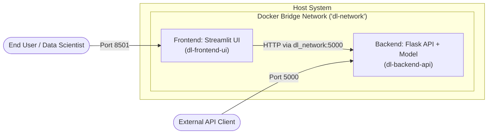

# Production Deployment Report: Deep Learning Multi-Container Microservice Stack

**Author:** Senior DevOps & ML Systems Engineer  
**Document Version:** 2.0.0  
**Stack Components:** Flask REST API (Backend) + Streamlit UI (Frontend) + Docker Compose  
**Orchestration Engine:** Docker Compose v2 / Docker Engine 24+  

---

## 1. Architecture & Design Specification

This architecture decouples the **Model Inference Serving Layer** (Flask API) from the **Presentation Layer** (Streamlit UI) to adhere to cloud-native microservice design patterns:



### Architectural Advantages
1. **Independent Scaling:** Backend inference workers can be scaled horizontally (e.g., via Kubernetes HPA or ECS replica sets) without rebuilding the UI.
2. **Resource Isolation:** Memory-intensive tensor operations are isolated from frontend web workers, preventing UI memory leaks or event-loop starvation.
3. **Internal Service Discovery:** The frontend connects to `http://backend:5000` via Docker's embedded DNS engine without hardcoding IP addresses.

---

## 2. Directory Layout

The workspace is organized into clean, decoupled submodules:

```
flask_dl_deployment/
├── backend/
│   ├── app.py                 # Flask REST application with model inference logic
│   ├── requirements.txt       # Backend dependencies (Flask, Gunicorn, NumPy, Torch/TF)
│   ├── Dockerfile             # Hardened Python 3.9-slim image for API serving
│   └── .dockerignore          # Backend build context filtering
├── frontend/
│   ├── app.py                 # Streamlit dashboard, metric cards & Softmax distribution charts
│   ├── requirements.txt       # Frontend dependencies (Streamlit, requests, pandas)
│   ├── Dockerfile             # Hardened Python 3.9-slim image for Streamlit
│   ├── .dockerignore          # Frontend build context filtering
│   └── .streamlit/
│       └── config.toml        # Streamlit headless server flags & custom theme
├── docker-compose.yml         # Container networking, dependency graph & resource limits
├── README.md                  # Quickstart operational instructions
└── DEPLOYMENT_REPORT.md       # Comprehensive architectural audit & deployment report
```

---

## 3. Dependency Configuration

### Backend Dependencies (`backend/requirements.txt`)
```text
Flask==3.0.3
gunicorn==22.0.0
numpy==1.26.4
# Framework note: For PyTorch or TensorFlow, specify CPU-tailored binaries to maintain slim images:
# torch==2.3.0 --index-url https://download.pytorch.org/whl/cpu
# tensorflow-cpu==2.16.1
```

### Frontend Dependencies (`frontend/requirements.txt`)
```text
streamlit==1.35.0
requests==2.32.3
pandas==2.2.2
numpy==1.26.4
```

---

## 4. Production Dockerfile Specifications

### Backend Dockerfile (`backend/Dockerfile`)
- **Base Image:** `python:3.9-slim` (reduces base image from ~1GB to ~150MB).
- **Environment Flags:** `PYTHONDONTWRITEBYTECODE=1`, `PYTHONUNBUFFERED=1` (instant standard I/O streaming to Docker log collectors).
- **Layer Caching:** Copies `requirements.txt` independently before copying application code.
- **Pip Optimization:** `--no-cache-dir` to discard cached wheel tarballs.
- **Security:** Creates dedicated unprivileged `appuser:appgroup` system account.
- **Health Monitoring:** Built-in `HEALTHCHECK` with HTTP probe on `/health`.
- **WSGI Server:** Gunicorn with 2 workers, 2 threads, 60s timeout binding to `0.0.0.0:5000`.

### Frontend Dockerfile (`frontend/Dockerfile`)
- **Base Image:** `python:3.9-slim`.
- **Configuration:** Headless execution (`STREAMLIT_SERVER_PORT=8501`, `STREAMLIT_SERVER_ADDRESS=0.0.0.0`, telemetry collection disabled).
- **Security:** Non-root execution under unprivileged `streamlituser:streamlitgroup`.
- **Health Monitoring:** Probes native Streamlit endpoint `/_stcore/health`.

---

## 5. Multi-Container Orchestration (`docker-compose.yml`)

The orchestration file sets up:
1. **Isolated Bridge Network:** `dl-network` creates a private subnet for inter-container communication.
2. **Service Discovery:** Frontend targets `http://backend:5000`.
3. **Startup Ordering via Healthchecks:** `depends_on: backend: condition: service_healthy` guarantees that the Streamlit UI only launches after Flask passes readiness checks.
4. **Hardware Quotas:**
   - Backend: CPU Limit `1.5`, Memory Limit `1024MB`.
   - Frontend: CPU Limit `1.0`, Memory Limit `512MB`.
5. **Log Rotation:** `json-file` driver with max 10MB file size and 3 backups to prevent disk exhaustion.

---

## 6. Execution & Verification Runbook

### Step 1: Build & Launch Microservices
```bash
docker compose up -d --build
```

### Step 2: Verify Service Status & Health
```bash
docker compose ps
```
*Expected Output:*
```text
NAME              IMAGE                 COMMAND                  SERVICE    STATUS
dl-backend-api    dl-backend-api:1.0.0  "gunicorn --bind 0..."   backend    Up (healthy)
dl-frontend-ui    dl-frontend-ui:1.0.0  "streamlit run app..."   frontend   Up (healthy)
```

### Step 3: Verify Backend REST Endpoint
```bash
# Health check probe
curl http://localhost:5000/health

# Prediction inference
curl -X POST http://localhost:5000/predict \
     -H "Content-Type: application/json" \
     -d '{"inputs": [0.55, 1.20, -0.42, 0.88, 2.15]}'
```

### Step 4: Access Streamlit UI
Navigate to `http://localhost:8501` in your web browser:
1. Verify the green **🟢 Online & Healthy** indicator in the sidebar.
2. Select a preset feature vector or input custom floating-point values.
3. Click **🚀 Run Inference** to view predicted class, confidence, latency, and interactive Softmax probability distributions.

### Step 5: Streaming Logs & Teardown
```bash
# Follow logs
docker compose logs -f

# Graceful stop
docker compose down
```

---

## 7. Security & Compliance Checklist

| Security Control | Implementation | Status |
| :--- | :--- | :--- |
| **Least Privilege Execution** | Non-root users (`appuser` & `streamlituser`) | **Enforced** |
| **Attack Surface Reduction** | Debian Slim runtime, build-time cache stripping | **Enforced** |
| **Build Isolation** | `.dockerignore` filters secrets, logs, `.git`, caches | **Enforced** |
| **Resilience / Auto-Healing** | `restart: unless-stopped` + Docker `HEALTHCHECK` | **Enforced** |
| **Container Resource Protection** | Docker Compose memory & CPU limits | **Enforced** |
