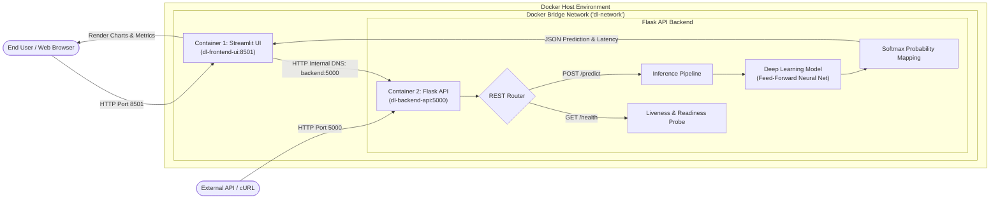

# Task 11: Full Application Containerization

[](https://www.docker.com/)
[](https://docs.docker.com/compose/)
[](https://flask.palletsprojects.com/)
[](https://streamlit.io/)
[](https://www.python.org/)

Production-ready multi-container deployment for serving a Deep Learning model via a **Flask REST API (Gunicorn WSGI)** backend and consuming it through an interactive **Streamlit UI** frontend, orchestrated via **Docker Compose**.

Developed for **L&T EduTech - Task 11: Full Application Containerization**.

---

## 1. Architecture Diagram

The diagram below illustrates the end-to-end request flow from the User to the Streamlit UI, across Docker's internal bridge network to the Flask API backend, and into the Deep Learning forward-pass pipeline:



---

## 2. Project Directory Structure

```
flask_dl_deployment/
├── backend/
│   ├── app.py                 # Flask REST API entrypoint & route handlers
│   ├── model.py               # Deep Learning model class (Feed-Forward Neural Net)
│   ├── requirements.txt       # Backend dependencies (Flask, Gunicorn, NumPy)
│   ├── Dockerfile             # Hardened Python 3.9-slim image for Flask
│   └── .dockerignore          # Backend build context filtering
├── frontend/
│   ├── ui.py                  # Streamlit UI dashboard, input sliders & Softmax charts
│   ├── app.py                 # Application wrapper pointing to ui.py
│   ├── requirements.txt       # Frontend dependencies (Streamlit, requests, pandas)
│   ├── Dockerfile             # Hardened Python 3.9-slim image for Streamlit
│   ├── .dockerignore          # Frontend build context filtering
│   └── .streamlit/
│       └── config.toml        # Streamlit headless server flags & custom theme
├── docker-compose.yml         # Container networking, dependency graph & resource limits
├── test_endpoints.py          # Automated verification test suite and latency benchmark
├── TESTING_REPORT.md          # Comprehensive assignment testing & validation report
├── SUBMISSION_GUIDE.md        # Instructions for PDF compilation and screenshot gathering
└── README.md                  # Project documentation & GitHub overview
```

---

## 3. Container Optimization & Best Practices

| Best Practice | Implementation | Benefit |
| :--- | :--- | :--- |
| **Lightweight Base Image** | `python:3.9-slim` | Reduces image footprint from ~1GB to ~150MB, minimizing attack surface. |
| **Layer Caching** | `COPY requirements.txt .` before source code | Prevents reinstalling dependencies when updating application code. |
| **Unprivileged Non-Root Users** | `appuser` (backend) & `streamlituser` (frontend) | Enforces Principle of Least Privilege, preventing host breakout vulnerabilities. |
| **Production WSGI Daemon** | Gunicorn (2 workers $\times$ 2 threads) | Replaces single-threaded development server for concurrent request handling. |
| **Inter-Service Networking** | Docker Bridge Network (`dl-network`) | Connects UI to API via Docker DNS (`http://backend:5000`) without exposing API to host if desired. |
| **Automated Health Probes** | Docker `HEALTHCHECK` on `/health` | Allows Docker Compose to delay UI startup until API is fully ready (`service_healthy`). |

---

## 4. Quickstart: Building & Running

### Prerequisites
- [Docker Engine](https://docs.docker.com/engine/install/) 20.10+
- [Docker Compose](https://docs.docker.com/compose/install/) v2+

### 1. Clone the Repository
```bash
git clone https://github.com/<your-username>/flask-dl-containerization.git
cd flask-dl-containerization
```

### 2. Build and Launch Containers
```bash
docker compose up -d --build
```

### 3. Verify Container Status
```bash
docker compose ps
```
*Both containers should display status `Up (healthy)`.*

### 4. Access the Applications
- **Streamlit Web UI:** Open [http://localhost:8501](http://localhost:8501) in your browser.
- **Flask API Root:** [http://localhost:5000](http://localhost:5000)
- **Flask Health Probe:** [http://localhost:5000/health](http://localhost:5000/health)

---

## 5. API Specification & Testing

### Test Inference via cURL
```bash
curl -X POST http://localhost:5000/predict \
     -H "Content-Type: application/json" \
     -d '{"inputs": [0.55, 1.20, -0.42, 0.88, 2.15]}'
```

**Expected JSON Response:**
```json
{
  "status": "success",
  "latency_ms": 1.45,
  "prediction": {
    "predicted_class": "Normal_Component",
    "class_index": 2,
    "confidence": 0.8924,
    "probabilities": {
      "Critical_Failure": 0.013,
      "Defect_Type_A": 0.0121,
      "Defect_Type_B": 0.0825,
      "Normal_Component": 0.8924
    }
  }
}
```

### Run the Automated Test Suite
```bash
python test_endpoints.py
```
*Validates root endpoint, health probe, nominal predictions, error routing (400, 405), Streamlit core health, and latency benchmarks.*

---

## 6. Teardown
```bash
docker compose down
```
To remove volumes and built images:
```bash
docker compose down --volumes --rmi all
```

---

## 7. Submission Documents
- Detailed testing outcomes: [TESTING_REPORT.md](TESTING_REPORT.md)
- Step-by-step PDF compilation instructions: [SUBMISSION_GUIDE.md](SUBMISSION_GUIDE.md)
